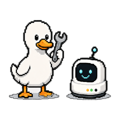

# AIPet

<table align="center">
  <tr>
    <td align="center"><a href="https://github.com/shreduck"></a></td>
    <td align="center"><a href="https://github.com/claude"></a></td>
    <td align="center"></td>
  </tr>
  <tr>
    <td align="center"><b>shreduck</b></td>
    <td align="center"><b>Claude</b></td>
    <td align="center"><b>Codex</b></td>
  </tr>
</table>

<p align="center"><i>AIPet is a collaboration between <a href="https://github.com/shreduck">shreduck</a>, Claude (Anthropic) and Codex (OpenAI): ideas, testing and direction by shreduck, code written together with both AIs in a cooperative environment experiment.<p align="center">No code was typed by humans in this project.</i></p>

AIPet helps you keep track of your AI threads (Claude Code, Claude Cowork and Codex) while you focus on your work, and
calls for your attention when one needs you. One little robot per session sits at the edge of your screen; it lives in
the system tray (Windows) or the menu bar (macOS) and installs its own hooks.

- **AIPet menu window** with search and an explanation for every option; settings live in one `config.json` that applies
  as soon as you save it
- **States at a glance**: working, needs you, a question, done, error / usage limit, idle
- **Sounds**: soft two-note chimes for done, needs you and error (or your system's sounds)
- **Answer from the pet**: permission prompts (Allow once, Allow + whitelist, Deny) and Claude's questions
- **Auto approve** with whitelists and blacklists per install
- **Click a pet** to jump to its session; **compact mode** for one pet that stands in for all sessions
- **Local**: no account, no telemetry; the only automatic connection is a daily update check on GitHub

> **Renamed from Claude Pet.** On its first start AIPet explains the changes and moves you over: it closes the old
> app (or asks you to quit it), copies settings, backups and sessions from `~/.claude-pet` to `~/.aipet` (the old
> folder is kept and still read until every hook is updated), moves *Start with Windows / at login*, and then offers
> to update the hooks in `settings.json` (old `claude-pet-hook` entries are recognised and replaced, with backups).
> Re-upload the Cowork plugin (`aipet-cowork-plugin.zip`) after uninstalling the old one.
>
> Hooks and plugins still on the old name keep working, but once a day AIPet lists what is left and how to update it
> (`settings.json` hooks, the old Cowork / CLI plugin, sessions still arriving through `~/.claude-pet`); *Claude Code
> hooks > Check for old Claude Pet hooks...* runs the check on demand. All of this lives in `legacy.py` plus lines
> marked `LEGACY`, so it can be removed in a later version.

| Pet | Meaning |
|---|---|
| Bobbing and humming (wavy mouth, slow blink) under a scrolling terminal bubble | working |
| Jumping, "?" face, ✓ ✗ ? bubble, needs-you chime | a permission prompt needs you (re-reminds every 90 s until you click it) |
| Jumping, single "?" bubble | the AI is asking you a question |
| Green check seal, happy face | done (working pets also flash the check briefly when a subagent or another session finishes) |
| Worried face, shaking, ✗ bubble, error chime | error: an API error such as a usage limit (with the reason), or a Workbench error |
| Asleep, floating z's | idle |

Pets keep their position: a session stays where it first appeared (new ones join on the left) even when its state changes; only if there are more than `max_pets` are the least urgent dropped.

Each pet shows small badges for where its session runs: **Claude**, **Cowork** (Claude app), **Codex**, **WSL**, **VS Code** or **Workbench** (shortened to `CC`, `CW`, `CX`, `VS`, `WB` when several don't fit). Only the robot and its "needs you" bubble catch clicks; the rest of the pet window lets clicks through to what is behind it (turn off with `"click_through": false` in `config.json`). The tray icon takes the colour of the most urgent session, and hovering it shows a summary.

Each AI's **context in use** comes first in that column, e.g. **CL ctx 84k/~200k** or **CX ctx 45k/258k**: the tokens of the session's latest request and the context window they fill. Codex reports its window; Claude transcripts don't, so Claude's is estimated from the model (200k, or 1M for a `[1m]` model or once the context passes 200k) and marked with `~`. Set `context_windows` in `config.json` to correct it (for example `{"opus": 1000000}`); switch the row off with **Appearance > Context beside the pet** (or `context_banner`: `false`). Compact mode shows the fullest session per AI; hover for every session's reading. The session tooltip lists the context too. The figures come from the agent tracker's transcript reading, so they also work where the status line doesn't run.

Account usage appears beside the pet as small coloured badges: **CL** for Claude and **CX** for Codex, with separate **5h** and **7d** percentages used. Compact mode merges equal readings per AI and uses the newest reading from each harness. Unknown or expired limits are hidden. Codex reads reported limits from its local rollout and skips rereading unchanged files. Readings are stored per session in `~/.aipet/usage` and removed with their session (stale, dismissed or cleared); an hourly sweep deletes any left over for more than a day. Optional usage collection cannot block session updates or permission prompts.

Claude has two separate options, both off by default:

- **Claude Code hooks → target → Claude usage status line...** enables the CLI collector after a confirmation that explains the change. Hook installation itself does not change your status line. On Windows the status line command is written without quotes or spaces (8.3 short folder names if needed) so it also runs when Claude Code uses PowerShell because Git Bash is missing; if that isn't possible, AIPet refuses and keeps your settings. The collector wraps an existing command through Bash (including Git Bash on Windows) and adds one process per refresh, or adds a usage line if none existed. Restoration data lives in `~/.aipet/statuslines`, not in Claude's settings schema. Disabling the collector restores the previous setting unless you have edited the wrapper yourself. Updating from v0.3.1 backs up and restores its automatic wrapper once. VS Code and desktop sessions may not emit this data.
- **Claude account usage (unofficial)** enables the credential-based fallback after a warning. It reads Claude Code's existing OAuth token or macOS Keychain item and calls an unofficial endpoint, which is not part of Anthropic's public API and may change or break. macOS may show Keychain access prompts. Anthropic restricts third-party use of subscription credentials; check that your use is permitted. The collector saves quota figures, not tokens, polls at most once every five minutes per login store, and stops accessing credentials when disabled. Its figures are labelled **Claude Code account · local login**; that account may differ from your desktop app account. See [Anthropic's credential rules](https://code.claude.com/docs/en/legal-and-compliance).

Hover a usage badge for its reset time and reporting source. Session and usage tooltips share the pet's pixel border, monospaced text, and colored heading; both open above the pet, clear of its body and badges. **Appearance → Tooltip text size** sits beside pet size in the right-click menu and windowed settings, adjusts both tooltip types from 50% to 250%, and defaults to 100%. The saved setting is independent of pet size. **Appearance → Tooltips → Session details / Usage details** in the right-click or tray menu lets you disable each kind separately; choices are saved. On macOS, tooltips and permission cards use non-activating panels so opening them does not pull you to another desktop. Hovering a pet also leaves the agent window behind the current app.

Finished pets show a green checkmark seal; speech bubbles are reserved for active work and interaction. Pets without usage data reserve no individual usage strip; a shared edge margin keeps the rightmost pet stable during normal usage transitions. **Show on all desktops** is available on macOS and Windows. **About AIPet** links to the app page, Duck Software and GitHub and follows the app theme.

### macOS diagnostics

Run **Actions → macOS self-test → Run workflow** after pushing your changes. Each `selftest-app` / `selftest-source` artifact includes a `spaces` folder with screenshots, native window flags, an HTTPS update check and `summary.json`. The probe checks desktop visibility on/off, hide/show, and compact resizing. It also tries to create and switch to a second Space, verifying the switch with a separate window that stays on the original desktop. Accessibility or desktop automation restrictions are reported as **skipped**, rather than a successful desktop test. Full-screen application visibility still needs a check on a real Mac. Share both artifacts to diagnose failures.

## Build the exe
On Windows with Python 3.10+, double-click **`build.bat`**. It produces the portable folder `dist\AIPet` (with
`AIPet.exe` and `aipet-hook.exe` sharing one Python runtime in `_internal`) and the same folder zipped as
`dist\AIPet-windows-x64.zip`. The build recipe is `aipet_app.spec`.
**Prebuilt:** the **Build AIPet** GitHub Actions workflow runs on every push to `master` (or by hand) and publishes `AIPet-windows-x64.zip`, an Apple Silicon `AIPet-mac-arm64.zip` and the same app as a smaller
`AIPet-mac-arm64.dmg`, plus `AIPet-all-platforms.zip` (the Windows zip and the Mac disk image in one file), to the rolling **latest** release on the repo's [Releases](../../releases) page; pushing a `v*` tag makes a versioned release. No binaries are committed. The Mac app is unsigned: unzip it, then right-click it and choose *Open* the first time.

The exe is unsigned, so the first time you run it SmartScreen may show "Windows protected your PC". Click *More info → Run anyway*.

## Use it
Unzip `AIPet-windows-x64.zip` anywhere (it's a portable app: nothing is installed) and run `AIPet.exe` inside the
`AIPet` folder. The pet appears bottom-right and a tray icon appears near the clock. Installing hooks copies the hook
and the part of the runtime it needs to `~\.aipet\bin`, so the folder can be moved or replaced later.

**Pet and menu-bar / tray menus**
Both menus share these sections; right-clicking a pet adds **This session** for details, opening its window or folder,
marking it finished, and dismissing it. On macOS, right-click and Control-click open a native context menu without
activating the pet or switching away from a full-screen app.

**AIPet menu...** (it used to be called *Settings...*) is the first item of every menu. It opens a window with the same
options grouped by section (General, Live Management, Appearance, Behavior, Integrations, Permissions, Help), each with an icon and a short explanation, plus a search
box. Every switch and button runs exactly the menu's action, and the window stays in step with changes made from the menus.
Its size is adjustable (Appearance → Window scale, or Ctrl + plus / minus / 0 and Ctrl + mouse wheel; Command on a Mac).

**Settings files.** Everything lives in `~/.aipet` (`%USERPROFILE%\.aipet` on Windows); *Open config and data folder*
(General) opens it. Hand edits of `config.json` apply within about two seconds (a few keys such as `workbench` need a
restart, and the app says so). *Copy settings guide for AI* (AIPet menu → General) puts a Markdown guide on the clipboard:
the folder, which files may be edited, every `config.json` key with its current value and allowed values, and the
`auto-approve.json` format. Paste it into Claude, Codex or another assistant and ask it to change AIPet for you.

**Nothing piles up.** A minute after start and then hourly, AIPet clears what it no longer needs: session files after
`stale_hours` (12 h), usage readings of sessions gone for a day, half-written files and the waits / answers of hooks
that were killed (after an hour), expired timed auto approves, the debug logs once nothing has written to them for a
week (and they are size-capped meanwhile), and saved diagnostics after 30 days. Backups keep the original plus the
newest few per install. Transcripts are only ever read, never copied.

**Questions from Claude** (its AskUserQuestion tool) open in the pet's popup like permission prompts: each question with
its options (check boxes when several may be picked) and a field for your own answer. *Send answer* hands the answers to
Claude Code, which carries on as if you had answered there. Auto approve never answers a question, and a question is
never hidden as a stale prompt. **Codex questions** show too, read-only: the current AIPet hook integration handles
Codex approval decisions, not question replies. The card shows the question and its options; *Go to window* takes
you to Codex to answer.

**API errors** that end a turn (usage limit reached, overloaded, billing, signed out...) show the session as an error,
with the reason, until you send Claude a new message. Permission prompts that Claude Code settles by itself (auto mode,
an allow rule) or that belonged to a subagent that stopped no longer leave a pet stuck on "needs you".

- **Appearance**: pet size, compact mode, theme, window scale, session titles, tooltips, and *Alpha* (the old Mole and
  Cat styles, no longer maintained).
- **Behavior**: desktop visibility, position, click behavior, sounds and notifications (sound style, *Test sounds*),
  session timing, and startup.
- **Integrations**: Claude Code and Codex hooks; *Extra* holds usage collection, *Run setup again*, re-detection and
  the Workbench status.
- **Permissions**: auto-approve rules grouped by agent, and separate Claude Code and Codex toggles for answering prompts from the pet.
- **Help**: About, updates and diagnostics.
- **AIPet menu...**, **Show / Hide pet**, **Clear finished sessions**, **Open config and data folder** and **Quit AIPet**
  stay at the top level. Left-clicking the Windows tray icon toggles visibility. On Windows the pet's right-click menu is
  a native menu, like the tray's.

**Integrations → Claude Code hooks**

- **This PC (Windows)**: installs into `%USERPROFILE%\.claude\settings.json`. Covers terminal and VS Code sessions on Windows.
- **WSL: \<distro\>**: one entry per auto-detected distro. Installs into that distro's `~/.claude/settings.json` and covers terminal and VS Code Remote-WSL sessions there. Stopped distros aren't booted just to show their status. They only start when you install or remove hooks.
- Each target shows its status (✓ installed, not installed, needs python3, …) and offers *Install / update* and *Remove*.
- **Cowork (Claude desktop app)...**: builds the Cowork plugin and shows how to install it (see below).
- The pet's right-click menu has the same *Claude Code hooks* submenu.

What hook install does:
1. Copies the hook to `~\.aipet\bin` (deliberately outside AppData: apps started from a packaged app such as Claude Desktop get AppData writes redirected to a private copy that the CLI and WSL cannot see). Nothing is copied until you choose Install; an existing install is refreshed when the app starts, so updates reach every target.
2. Asks for confirmation, then backs up the current `settings.json` (see below).
3. Adds the hook entries and keeps every other hook and setting. It never overwrites a `settings.json` that isn't valid JSON. Running install again changes nothing if the hooks are already up to date.

Only Claude Code sessions started *after* installing will appear.

### Backup & restore
Each target's submenu also has **Restore backup**, **Back up now** and **Open backups folder**.

- **Automatic backups:** taken before every install, remove or restore, and only when the file actually changes.
- **Storage:** backups are byte-exact copies kept in `~\.aipet\backups\<target>\`. WSL backups are stored there too, so browsing them never starts a distro.
- **"No file" state:** if `settings.json` didn't exist yet, that is recorded as well. Restoring it deletes the file again.
- **Retention:** the **oldest backup is always kept** (labelled *[original]*, your settings from before AIPet first touched them), plus the 20 most recent.
- **What the menu shows:** each backup's date, reason, and whether it contains AIPet hooks. It also warns if that version isn't valid JSON.
- **Undo:** a restore first saves the current file as a *before restore* backup, so it can be undone from the same menu.
- After restoring, restart running Claude Code sessions to pick up the change.

Backups are plain copies of your `settings.json`. If you keep secrets in it (e.g. under `env`), the copies contain them too. They stay in your own user profile.

**Pet:** hover for details, click to acknowledge a pet that needs input (or dismiss a done one), drag to move. Right-click opens the menu, including *Open in VS Code*.

## Taskbar / Dock / menu bar icon
The tray icon (Windows) and the Dock icon (macOS) show the robot: white normally, **red** with a "?" face while a session
needs you (worried face on an error). On macOS the Dock icon also bounces once when that starts.

On macOS AIPet also has a **menu-bar icon** (top right): a line-art robot in the menu bar's own colour, red while a
session needs you. Its menu is the same as the Windows tray menu (hooks for Claude Code and Codex, compact mode, sounds,
theme, sizes, timeouts, start at login, quit...). It is built with the Objective-C runtime directly (`mac_statusbar.py`),
so no extra packages are needed.

## Codex
AIPet also shows **Codex** (OpenAI's coding agent) sessions, with a green `CX` badge. Codex has the same kind of hooks as
Claude Code, kept in `~/.codex/hooks.json` (or `$CODEX_HOME/hooks.json`):

- The setup window and *Integrations > Codex hooks* list every place Codex is found: this PC and each running WSL distro
  with `~/.codex` or `codex` on the PATH. Install / update / remove / backups work like the Claude Code targets.
- **Trust step:** Codex only runs hooks you have trusted. After installing, start Codex, type `/hooks` and trust the AIPet
  hooks (Codex asks again only if they change).
- Codex permission prompts can be answered from the pet's prompt window (Allow once / Deny), like Claude's. One
  difference: Codex asks its permission hook *before* showing its own prompt, so Codex's prompt only appears if you
  don't answer in the pet's window within the answer timeout. To have Codex show its prompt straight away instead,
  switch off **Answer Codex prompts from the pet** (menu or tray). Updating from an older AIPet needs the Codex hooks
  updated once (they get a longer permission timeout) and trusted again in `/hooks`.
- **Codex questions** (`request_user_input` and `request_user_input_async`) show on the pet with their options,
  read-only. AIPet also reads pending question calls from the local rollout, so a blocking question appears before
  its completion hook arrives and clears after it is answered. Answer in Codex (*Go to window*); the pet's Codex
  permission-answer toggle controls Allow/Deny approvals, not question replies.
- Events: start, prompt, tool use, permission, stop, **Interrupt** (shows as done), session end and subagents. Codex has no
  `Notification` event.

## Cowork (Claude desktop app)
Cowork runs its own Claude Code with a private config folder, so it never reads `settings.json` and the hooks above don't reach it. It does run plugin hooks, on Windows itself (not in its Linux sandbox), so AIPet ships its hooks as a plugin. Only the Claude app can install plugins, so this step is manual:

1. The setup window and *Claude Code hooks > Cowork (Claude desktop app)...* write `aipet-cowork-plugin.zip` next to `AIPet.exe` (or to `~\.aipet` if that folder is read-only). The zip is refreshed at every start once hooks are installed.
2. In the Claude app: **Customize > Plugins > upload** the zip, and keep the plugin's hooks enabled.
3. Restart the Claude app and start a new Cowork session.

Cowork ends its session after every reply, so a Cowork pet isn't removed then: it turns *done* and is cleared after the **Clear finished after** time, like any finished session. Your next message brings it back.

Cowork sessions get an orange **CW** badge and are named after the folder you connected to the session (`Name +2` when there are several), or after your first prompt when no folder is connected.

The plugin (`pet-hooks`) calls the same hook as `settings.json` (`~\.aipet\bin`), so updating AIPet updates it too. Remove it from Customize > Plugins.

**Claude Code CLI:** the same window shows how to install the plugin from a local marketplace in `~\.aipet\plugin-marketplace`:
```
claude plugin marketplace add "%USERPROFILE%\.aipet\plugin-marketplace"
claude plugin install pet-hooks@desktop-pet-local
```
Use it *instead of* the settings.json hooks, never both, or every event reaches the pet twice.

## Compact mode
*Compact mode (one pet)* in the right-click or tray menu shows a single pet for all sessions, with a robot per session
(up to four; a `+N` badge counts the rest), each robot in its own session's state. The pet's name tag, badges, bubble and
click belong to the session in front:

- Sessions that need you **queue up** in the order they asked. The first one is in front with a `N waiting` badge; answer
  it and the next one steps forward.
- With nobody waiting, the most urgent / most recently active session is in front.
- The name tag scrolls through every session's title like a banner, each after its state symbol in a faded state colour: `❃` working (blue), `❉` waiting for you (red), `✺` done (green). Each session's conversation title runs right below its name in small text (cut with `…` when long), and both lines scroll together.
- Hover the pet for a list of every session.
- The badges collapse into one: different agents are listed by name (`Claude + Codex`), a single agent gets all its tags (`Claude Cowork+WSL+VS`); it turns faint red if any session needs you. Click it (`▴`) to show one badge per session in a column snapped to the pet's left side (a second column further left if it fills up), each with its conversation's title on a second, smaller line, and `▾` to collapse again.

## WSL notes
- The WSL hook is a Python script, so the distro needs `python3`. Ubuntu has it by default. Otherwise the menu shows *needs python3*; install it in the distro (e.g. `sudo apt install python3`).
- The hook writes into your Windows `.aipet` folder through `/mnt/c`. That path is set in the hook command, so nothing else needs configuring.

## Clicking pets, bubbles
- **Conversation titles on the name tag:** the name moves to the top of the tag and the conversation's title sits below it
  in small text; a line too long for the tag scrolls round instead of being cut. Sessions that share a folder name also get it in
  their tooltip and prompt window (`esign-online · Fix login bug`). The title is the name the harness shows: for Claude Code your `/rename` name (`custom-title` in
  the transcript), else the name Claude Code gave the session (`agent-name`, kept for good once seen); for Codex the
  thread name from `~/.codex/session_index.jsonl` (renames follow). Right-click (or tray / menu bar) > *Session titles* switches between *Session name* (the default)
  and *Last prompt* (saved as `"session_titles"`: `"name"` / `"prompt"`). Without a name, the latest prompt you typed (a
  short session id before that).
- **Click a pet** to acknowledge it and bring its window to the front: the terminal or Claude desktop app that hosts the
  session (the hook records the window), or the right VS Code window for VS Code sessions. WSL terminals are best effort
  (matches a Windows Terminal window by distro/project, else the only/frontmost one). It cannot pick the tab inside a
  Windows Terminal window or the conversation inside the desktop app.
- **VS Code extension sessions** go one step further: after raising the window that holds the folder (also when VS Code
  has a parent folder or a `.code-workspace` open), the pet opens that conversation's tab through the extension's
  `vscode://anthropic.claude-code/open?session=<id>` link (Claude Code 2.1.72+). Claude Code run in VS Code's terminal
  only gets its window. Turn it off with `"vscode_open_conversation": false` in `config.json`.
  The open folders are read from VS Code's live window list (`backupWorkspaces` in `globalStorage/storage.json`), then
  the older `Backups/workspaces.json`, then the saved window state; on macOS paths are compared case-insensitively and
  with symlinks resolved. *Save diagnostics...* shows how many folders each source reported.
- **Click goes to the session's window** (right-click, tray or menu bar; on by default, saved as `click_to_focus`):
  switch it off and a click only acknowledges the pet. The prompt window's *Go to window* still works.
- **macOS: Show on all desktops** (on by default, saved as `all_spaces`): the pet stays visible when you switch desktops
  (Spaces, e.g. with a three-finger swipe) and over full-screen apps.
  The overlay uses a non-activating native panel; macOS 13 and later also enable sharing with other apps' full-screen
  Spaces and Stage Manager sets. After updating from an older build, restart AIPet to recreate its window.
- **Click a badge** to open that session's prompt window if it needs you (in compact mode, each badge is one session), or to go to its window otherwise.
- **Dismiss** a pet from the right-click menu (*Dismiss this pet*) or with *Clear finished*; clicking no longer dismisses.
- When a session **needs you**, the robot's **check / cross / "?" bubble** is clickable (hand cursor): it opens an
  **independent popup** with what Claude wants to run (the tool, its description and the command), where it runs and how
  long it has waited. Clicking the robot itself goes to the session's window. The popup closes by itself when the session
  stops needing you. Sessions that send only a notification (the VS Code extension) still show the question: the hook
  recovers it from the end of the session transcript, but those prompts can't be answered from the pet.

## The pet, subagents, resizing
- The default pet is a little **robot** (a PC) from the pixel art in `assets/reference/duck-robot.webp`; the sprites are in
  `assets/sprites` and regenerate with `python tools/make_sprites.py`. **Working:** a wavy mouth that travels as it
  hums, a slow blink, cycling lights and a bubble of scrolling hacker text; it briefly shows the done check when one of
  its subagents or another session finishes. **Needs you:** a "?" on its screen, flashing amber lights, a hop and a
  check / cross / "?" bubble (a single "?" for a question). **Done:** a green check seal. **Error:** worried face, a
  shake and a cross. **Idle:** asleep (eyes closed, lights off, floating z's). The state colour shows on the name tag.
- **Appearance → Alpha** keeps the older *Mole* and the original *Cat* styles (switch one off to go back to the robot);
  they're no longer maintained. Without Pillow or the sprite files the app falls back to the mole.
- A session that runs **subagents** shows extra robots next to the main one (up to four), and the state line shows `+N`.
  This relies on the hook payloads carrying an `agent_id` (finished agents drop off after `SubagentStop` or 90 s without
  activity). A subagent's tool call no longer hides a permission prompt that belongs to a different agent.
- **Resize** with the slider: pet or tray menu > *Appearance > Pet size...* opens a small window with a 30% - 300%
  slider; the pet follows it live and the value is saved as `size` (1.0 = 100%). 100% is the default size (twice the drawing
  size the first versions used; an older `scale` value in `config.json` is converted once). *Reset size* restores 100%.
  The pet keeps its bottom-right corner while it grows or shrinks, but stays on the screen it is on (on macOS too, kept
  above the Dock; the screens are read from NSScreen). If it is ever lost off screen, *Reset position (main screen)* in the tray
  menu or the macOS menu-bar menu puts it back in the main screen's bottom-right corner.

## Answering permission prompts from the pet
When Claude Code or Codex asks for permission, the popup (click the bubble) shows **Deny**, **Allow + whitelist** and
**Allow once**. Your click is handed to the `PermissionRequest` hook, which prints the decision to the agent.
- **Allow + whitelist** also adds the request to that install's auto-approve whitelist as an exact match: the whole
  command (or file path, URL...), or the tool itself for MCP tools. If the install still had only the default
  ask-everything blacklist and no rules, that blacklist is cleared so the exact match can apply.
- **Several prompts at once** (parallel tool calls, subagents) queue up: the card shows the oldest, "N prompts waiting",
  and moves on to the next one after you answer. *Not asking anymore? Clear this prompt* removes one that's gone.
- **Card size:** a slider under the robot (50% - 150%), or Ctrl + plus / minus / 0 and Ctrl + mouse wheel on the card;
  saved as `card_scale`.
- Under **Permissions**, **Answer Claude Code prompts from the pet** and **Answer Codex prompts from the pet**
  independently control manual answering for each assistant. Turning one off hides its answer buttons and stops its
  hooks waiting for the pet, including requests already waiting. Answer those requests in the assistant instead.
  Claude answering is on by default. These toggles do not change **Auto approve** rules.
- The hook waits up to the **answer timeout** (default 3 minutes, set 0 - 30 minutes with right-click > *Behavior > Session timing > Answer timeout...*
  or tray > *Answer timeout...*; 0 = no limit, it waits until you answer) and **only while the pet is running** (it checks a
  heartbeat file). If you don't click, or the pet is closed, it prints nothing and the normal prompt appears as usual.
  It also stops waiting as soon as the prompt is answered in Claude Code itself.
  The setting is saved as `answer_wait_seconds` and mirrored into `~/.aipet/answer-wait` for the hooks.
- Claude Code (CLI/desktop) shows its own prompt at the same time and the first answer wins, so you can still answer there.
- For background subagents Claude Code may wait for the hook before showing its own prompt, so a long timeout also
  lengthens that delay (with no limit, until you answer from the pet); lower the slider if you notice it.

## Live Management and timed auto approve
**Live Management** (any menu, and its own page in the AIPet menu window) lists your running sessions. For each one:
- **Auto approve for N min...** approves every permission prompt from that session by itself until the timer ends,
  after a confirmation (Enter doesn't confirm it). Other sessions keep asking, and questions from the AI still wait for
  you. The prompt card has the same thing as a link: *Auto approve this session for N min...* (it also allows the
  prompt on screen). The length is a slider in the AIPet menu window (1 - 120 min, default 10; `timed_approve_minutes`).
- While one runs, its countdown shows in Live Management and at the top of the pet's right-click menu
  (*Stop auto approve: name · 7:32 left*), one click to stop it early. It also stops when AIPet quits (the hooks only
  honour it while the pet runs). Grants are kept in `~/.aipet/auto-approve.json` under `timed`.
- **Subagents running** lists what the session's subagents are (their agent type, e.g. `tester`).
- **Agent network window** (a switch here and right below *AIPet menu...* in the pet's right-click menu; each
  session's entry also has *Agent network...* to open it on that session) opens or closes the window below, and
  **Agent network compact mode** chooses one window for every session or one per session.

## Agent network window
A live map of one session: the main agent and every subagent it started, Claude Code and Codex alike.
- A one-time invitation offers **Try it** or **Not now**. Either choice, or closing it, prevents another invitation;
  the view remains available from the AIPet menu.
- **Nodes** carry a small copy of the pet's robot (red when that agent needs you), the agent's name (a Claude Code
  subagent's description, e.g. *Find the callers*, with its type under it; Codex's own nickname), model, reasoning
  effort and, on its own line, its context and the tokens it used so far (*ctx 84k/~200k 42% · Σ 1.2M*; the window is
  reported by Codex and estimated for Claude, as beside the pet; *≥* while only the end of a long transcript has
  been read), and its state. Edges show what is going on: blue with dots
  flowing out while a subagent works, amber while the main agent waits on it, green with a dot flowing back once it
  handed back its result (what each one says and does is in the logs). An agent started by a subagent sits in a
  column further right, linked to the subagent that started it (Claude Code records it in the subagent's
  `.meta.json`, Codex in the rollout's `parent_thread_id`).
- **Tool nodes** sit under the agent that called them, with a gear icon. Each unique tool, including MCP tools,
  gets one node per calling agent. Clicking it selects the calling agent and filters its log to that tool's inputs
  and outputs, matched by call ID. The graph settings include a **tool calls** toggle. Tool nodes do not count as subagents
  or add model context to the stats. A tool node counts its calls for the whole session and for this task (since your
  latest prompt): *12 calls · 2 this task*; the stats node's *tools* line and drop-down give both too.
- Finished subagents remain visible across new messages until unused for **80% of Clear finished after**
  (3 minutes means 2 minutes 24 seconds). Reuse resets the timer; active agents and their parent branches stay
  visible, and setting the session timeout to **never** also disables subagent expiry.
- **Logs** below the graph, or above, left or right of it (settings: *logs position*). *[− logs]* at the end of the
  tabs (or `l`, or *folded* in the settings) folds them down to their tabs and gives the graph the room; *[+ logs]*
  brings them back. Every other entry is shaded,
  and each agent's final reply (its result) is tinted green with a green mark before it. Drag the line between graph and logs to
  resize them (up to 80% of the window); *tail* (settings, or `[tail ▼]` at the end of the tabs) follows the newest
  line, and unfolding an entry switches it off so what you opened stays in sight; select text and Ctrl+C to
  copy; what an agent said is there in full, its final reply being its result; long entries show their first line
  with `›`: click to unfold, `‹` to fold, right-click for expand / collapse, copy text and open in a window, a plain
  text window titled after the reply, with a copy button): *[all]* merges every agent's activity into one log (prompts, what each one said, tool calls,
  results), each line in its agent's colour; the other tabs select one agent, including its tool calls. The first
  line of each model request ends with its tokens (*in 84k · out 1.2k*: the prompt it sent, the answer it got), and
  one agent's tab header sums what that agent used (*Σ tokens*, with cached input); the stats node's *context*
  drop-down lists the same sum per agent.
- **Log filters** have their own bar below the agent tabs: **show tools**, **primary** (user queries and final results),
  and separate **tools** and **MCP** dropdowns with a checkbox per unique tool. Clicking an agent node clears the
  filters and shows that agent's full log; clicking a session title clears them for its combined log.
  Tool nodes filter to their tool. **Clear filters** also restores the full log. The controls wrap when the log pane is narrow.
  Tool nodes do not add tabs to the agent bar.
- **Prompts**: when an agent needs you, a small warning shows (*Plan needs your input*). Click it (or press Space) and
  it opens over the log with the prompt or question and its answers (side by side when they fit, one per line when
  they don't); Esc folds it back. A question's answers are a pick-one list with *Your own answer:* as the last one:
  type in its box and press Enter to send exactly that. Several questions show one at a time (*question 2/4*, with
  ‹ › or ←→ to move between them, ● the one shown, ◉ answered): picking an answer moves on, a pick-any question
  has check boxes and *next question ›*, and *send answers* (or answering the last one) sends them all together.
  Clicking the node of the agent that is asking opens its prompt too. Next to *allow once*, *deny* and
  *aipet: always (whitelist)* (AIPet's own auto-approve list), Claude Code prompts list Claude Code's own choices
  when it offers them, marked *claude:* (e.g. *claude: allow Bash(npm test:\*) always, in this project*, or a
  permission mode for this session); picking one allows the prompt and Claude Code saves that rule itself. Codex
  doesn't offer such choices to hooks: use *answer in codex* for its own. *aipet: auto approve this session for N min…*
  works as on the card: after its confirmation every prompt of that session is approved for a while, this one too.
- **Codex prompts and Go to window**: while AIPet's hook holds a Codex prompt, Codex waits for it and shows nothing.
  *Go to window* (on the card) and *Answer in Codex* (in the agent network) hand the prompt back, so Codex shows its own
  prompt with all its choices, like always allowing that tool. Claude Code shows its own prompt alongside the pet's
  anyway, so there it only jumps to the window.
- **A prompt the agent stopped**: if Codex or Claude Code ends AIPet's waiting hook without a decision, the card says
  so and after how long ("Codex stopped AIPet's prompt after 14 s"). A hook stopped politely records it; one killed
  outright leaves its `answers/*.waiting` file behind, which the pet reads as stopped. If the agent then shows no prompt
  of its own, interrupt the turn there (in Codex, also check whether *Approve for me* is on).
- **Settings** drop down from the cogwheel at the top right (it turns while open), in three parts (window, graph,
  logs), kept in `config.json` under
  `agent_window` and applied to every open agent network window: `[on ]` / `[off]` always on top, title bar (off: drag
  the top bar to move; on Windows the window keeps its frame and taskbar button and resizes from its edges as usual,
  plus a wider frame to grab and the `◢` corner, as on Linux) and compact (like the pet's compact mode: one
  window for every session; off: each session gets its own window, titled after it and fanned out) with, in compact,
  tabbed (on: one session at a time, PgUp / PgDn switch; off: every session's graph in its own band, one under the
  other, each session's name a title bar on its main node; click a band to pick the session the logs and prompts
  follow; there, *tidy* draws each session as a group
  with a title bar instead, its name scrolling like the pet's name tags when it doesn't fit). A session that clears
  fades out, then the ones below slide up into its place; sliders for window opacity, background opacity (the graph's background; Windows and macOS) and node
  opacity, 30-100%, window scale, 50-150%, and text scale, 50-200% relative to the window scale
  (applied when you let go of the mouse, so the window doesn't move under it). Both scales default to 100%.
  Text scale adjusts the graph, logs and controls without enlarging the pet drawings.
  Background opacity shows the graph's background through a backdrop window of AIPet's own, so clicks never reach
  what is behind. Tk can't draw half see-through nodes, so node opacity is a dotted pattern (75 / 50 / 25%).
- **Stats node** (bottom right of the graph) for the current task, since your latest prompt: *subagents* (which kinds,
  how many times), *context* (the sum; its drop-down lists every agent call in order with its model and context, not
  grouped by name) and *tools* (every tool and how often, and the skills used). Click a line for its read-only
  drop-down; Esc or a click elsewhere folds it. A small `ⓘ` (hover it) shows when the task began before the part of a
  transcript initially available to the view: older entries may be missing while the background tracker catches up.
- **Zoom and pan** the graph: `[-] 100% [+] [reset] [center] [fit all]` at its top left, Ctrl + mouse wheel (at the pointer),
  + / - and 0; drag to pan, the wheel scrolls (Shift: sideways). The stats node and zoom controls stay put. Panning,
  scrolling and zooming stop where at least one node is still in sight (inside a 10% margin), and a view with no
  node in it re-centres by itself.
  On a Mac trackpad, two-finger scrolling pans smoothly in both directions, with system momentum and scrolling
  direction; pinch zooms around the pointer. Gestures over the logs and controls keep their normal behavior.
  **Center** places the average of the node centres in the viewport centre without changing zoom.
  **Fit all** adjusts zoom to show every node and title, leaving room for the fixed controls.
  The **auto** checkbox beside it (also **auto fit all** in the graph settings) automatically fits when an agent
  or tool node is added or removed, and after resizing the window or the graph/log split.
  Enabling it fits immediately; the preference is remembered across restarts.
- **Reset agent network appearance** (Appearance, next to Reset pet size, in every menu and the AIPet menu window) puts the default look
  back and centres the open windows on the main screen; one window or one per session stays as it was.
- **Size**: resizing preserves both scale settings. Raising the window scale grows the window to fit;
  use the graph's zoom and pan controls to navigate its contents in a smaller window.
- **Double-click the top bar** to maximise the window (and again to restore); maximised leaves the taskbar (or the
  menu bar and Dock) alone, also without a title bar.
- **Keys**: Tab / → next agent, Shift+Tab / ← previous, A shared log, ↑↓ scroll the log, PgUp / PgDn previous or
  next session, Space open / fold the prompt, Esc fold it or close the window. With the prompt open: 1-9
  pick and send an answer, arrows move between answers, Enter sends the highlighted one.
- Data comes from the session's transcript files: Claude Code keeps each subagent's in
  `<transcript>/subagents/agent-<id>.jsonl`, Codex writes each spawned agent its own rollout file. Read-only; nothing is
  sent anywhere.
- **Background tracking** stays active while AIPet runs, even with the agent view closed. It reads each transcript
  once, then only appended records, including sessions beyond the visible pet limit. Opening the view midway uses
  this cached history. Existing expiry rules still apply; history is bounded to 240 log entries per agent and 120
  completed calls per unique tool. Queries and final results have separate history so tool traffic does not bury them.

## Auto approve
**Permissions → Auto approve** (pet right-click, the tray icon's menu, or the macOS menu-bar icon) lists every hook config: *This PC /
This Mac*, each *WSL* distro, *Cowork* (the Claude app plugin) and each place *Codex* was found. **Everything is off by
default.** Each entry opens a window for that config:
- **Auto approve for this config** switches it on or off.
- **Whitelist** (approve automatically) and **Blacklist** (always ask me): one regex per line; empty lines and lines
  starting with `#` are ignored. Defaults: the whitelist is empty and the blacklist is `.*`, so nothing is approved
  until you replace it.
  - Patterns are matched against the command (or file path, URL, search pattern...), the tool name and `Tool(command)`,
    for example `git (status|diff)`, `npm test`, `Read` or `Bash\(ls\)`.
  - Whitelist patterns must match the **whole** text (`re.fullmatch`), so `git status` doesn't also approve
    `git status; rm -rf ~`. Blacklist patterns match **anywhere** (`re.search`). Tip: `[;&|`$<>]` makes chained and
    redirected commands ask.
  - The **blacklist always wins**; anything on neither list asks you as usual. An invalid blacklist pattern counts as a
    match, so a typo can only make the pet ask more. Save refuses patterns that don't compile.
- **Allow all** approves every request and greys out both lists.
- Switching a config on, or turning on Allow all, first shows a warning (Enter and Escape both cancel). *Turn all off*
  switches every config off and keeps the lists.

Details:
- Saved in `~/.aipet/auto-approve.json`; hooks read it on every prompt, so changes apply to running sessions at once.
- It only works **while AIPet is running** (the hooks check the pet's heartbeat) and with AIPet's hooks installed for
  that config; the menu marks configs without them. The VS Code extension sends no permission events, so it always asks.
- When the **whitelist** approves something, the robot shows steady green lights, a gentle bob and a small pale-green `✓ auto` bubble
  for 10 seconds, or until any session needs you. Its tooltip shows what was approved. *Allow all* approvals don't
  animate (they would never stop). The tray tooltip starts with `AUTO APPROVE ON` while any config is on.

## Stuck sessions
Every 15 seconds (pet or tray menu > *Behavior > Session timing > Health check every...*: 0 = off, up to 5 minutes; saved as
`health_check_seconds`) the pet checks that each working or waiting session's Claude Code / Codex process still runs. If
it has ended without saying so (the app was closed, or Cowork moved the conversation to a new session), the session is
shown as finished and the done timeout clears it. WSL sessions can't be checked from Windows: right-click > *This session > Mark as
finished* ends any stuck session by hand (in compact mode, the one in front).

## Clearing finished sessions
A finished session's pet is cleared after the **done timeout**: right-click > *Behavior > Session timing > Clear finished after...* (or the tray menu),
0 - 30 minutes, default 3 minutes; 0 keeps finished pets until you dismiss them. Saved as `done_timeout_minutes`.

The VS Code extension does not send `PermissionRequest` events, so its prompts keep the read-only bubble.

## New versions
Once a day (and from *Check for updates...* in the tray or menu-bar icon's menu) AIPet asks GitHub for the newest
published release, i.e. the newest `vX.Y.Z` tag (the rolling *latest* pre-release is ignored). If it is newer than the
running copy, a popup offers *Open release page*, *Later* or *Skip this version*, and the menus show *Update available:
vX.Y.Z...* until you install it. Nothing is downloaded or installed automatically: download the new `AIPet-windows-x64.zip` /
`AIPet-mac-arm64.zip`, quit AIPet and replace your copy (settings, hooks and backups in `~/.aipet` are kept).
- On by default; turn the daily check off with *Check for updates automatically* in the tray / menu-bar menu (saved
  as `update_check`). Updates are available under **Help → Updates** in both menus.
- The menus show the running version (*AIPet v0.2.4*). Builds take it from `git describe` (`tools/write_version.py`,
  run by `build.bat`, `build_mac.sh` and CI), so a local build two commits after v0.2.4 reads `v0.2.4-2-g<commit>` and
  counts as v0.2.4.

## Theme, diagnostics
- **Testing on macOS without a Mac:** run the **macOS self-test** workflow by hand (Actions tab). It starts the app on an Apple Silicon runner with fake sessions (`tools/seed_sessions.py`) and uploads screenshots plus the diagnostics report, for the packaged app and for the source.
- **Save diagnostics...** (pet right-click) writes `~/.aipet/diagnostics.txt` and opens it: versions, sprite loading, image tests, window state and recent errors. No prompts or session contents. Send it along with bug reports from machines that can't be tested here.
- **Light theme is the default.** *Appearance > Dark theme* (any menu or the settings window) switches live and is
  saved as `theme` in `config.json`. It covers the name tags, bubbles, tooltips and the permission popup, and also the
  setup, Cowork, slider and reminder windows, the confirmation / message dialogs (now cards in the pet's style), the
  pet's right-click menu and, on Windows 10 1903+ / 11, the tray menu and window title bars. macOS keeps its native
  menus. The one-time *Claude Pet* migration window stays native.
- **Log hook events (debug)** appends one metadata line per hook event to `~/.aipet/events.log` (event, tool name, field
  names, state change, VS Code detection hints - never prompts, commands or other values). Use it to diagnose odd pet states,
  e.g. a permission prompt that the pet shows as "working" because another subagent's tool call arrived in between.
  It also logs how each permission wait ended (`WaitEnded`: answered, released, timed out, answered elsewhere, answers
  off, pet closed, or stopped by the agent, with the seconds waited).

## First-run setup, notifications
- On first run a **setup window** lists the Claude Code installs it found (this PC, running WSL distros with Claude Code)
  and shows for each whether the hooks are missing, installed and up to date, or out of date. Nothing is written until you
  press *Install selected*. Reopen it any time: *Integrations > Extra > Run setup again*.
- **Notifications are off by default** (the Claude app already notifies). *Behavior > Sounds and notifications >
  Notifications* turns them on; the choice is saved in `config.json` as `notifications`. Sounds are a separate toggle.
- **Sounds:** AIPet's own soft two-note chimes by default (a rising one when a session is done, a falling one when it
  needs you, a low one for errors), written once to `~/.aipet/sounds`. *Sound style* switches to your system's sounds
  (Windows message beeps, or macOS Glass / Funk / Basso); *Test sounds* plays each one. Some USB DACs and headsets sleep
  between sounds and swallow the start of a short chime; if the first note sounds cut or crackly, disable USB selective
  suspend / the device's power saving.

## macOS
Apple Silicon builds come from the *macos* job of the GitHub Actions workflow (`AIPet-mac-arm64.zip` on the Releases
page), or build with `bash build_mac.sh` on a Mac. The script sets up an isolated build environment under the ignored
`build/mac-runtime` folder. It uses an available Python 3.12 with Tcl/Tk 8.6, or downloads Python 3.12.11 through uv
(pinned to preserve Tcl/Tk 8.6 compatibility). The first build needs internet access.
Set `PYTHON=/path/to/python3.12` to select a compatible runtime explicitly.
No system Python installation or shell profile is changed. The app is ad-hoc signed and signature-verified, but
is not Developer ID signed or notarized; downloaded builds may require right-click > Open on first launch. macOS
support is newer than Windows, and the **macOS self-test** workflow (see above) checks it on every change.
- **Smaller bundle.** The app and built-in hook share one identical Python library using a relative link inside the
  bundle. The build re-signs and verifies the app after this step. Installing the hook copies the library to its own
  runtime, so hooks keep working after the app is moved or replaced. Both Python.framework and libpython builds work.
- **Hook runtime.** The setup window offers *your Python 3* (faster) or the *built-in hook* (nothing to install, slower per
  tool call). If Python 3 isn't found it selects the built-in hook, warns that Python is faster, and offers help installing
  Python (python.org page, or Apple's Command Line Tools installer) - nothing is installed without your confirmation.
  `/usr/bin/python3` is never executed unless the Command Line Tools are present, because without them it is a stub that
  pops up Apple's installer dialog.
- **Menu bar instead of a tray icon:** pystray needs the main thread, which Tk already owns, so macOS gets its own
  menu-bar icon (see above) with the same menu as the pet's right-click (Control-click works too).
- Notifications use `osascript`, sounds use `afplay`, start at login is a LaunchAgent, backups and hooks live in `~/.aipet`.

## mcp-workbench Agents chats (optional)
Open the config folder from the tray and set `"workbench": { "enabled": true, "mcp_url": "<your endpoint>" }` in `config.json`. Put the key in an environment variable, not in the file: `setx WORKBENCH_MCP_KEY "<key>"`. The key needs the Agents grant.

To check what Workbench returns and how the pet reads each chat's state, run `AIPet.exe --probe-workbench`. It writes the report to `workbench-probe.txt` and opens it. If a state is read wrong, adjust `state_map` in `config.json`. Restart the app after changing the config.

## Run from source
```
pip install -r requirements.txt
pythonw aipet_app.py
```
Tests: `python -m unittest discover -s tests`. Architecture rules: `python tools/check_architecture.py` (also run by
the tests and the build workflow; see the script for the rules and `tools/architecture_baseline.json` for the
transitional counts that may only go down).
From source, the Windows hook runs via `pythonw` and the script, so no exe is needed.

## Files
| File | Purpose |
|---|---|
| `aipet_app.py` | Entry point: tray, application actions, autostart, config watcher |
| `aipet.py` | Pet runtime coordination, shared state and compatibility entry points |
| `aipetlib/runtime/` | Paths, live preference holders, reading and saving `config.json`, and the error log, shared by the app and background workers |
| `aipetlib/agents/` | The agent network backend: Claude/Codex transcript adapters, incremental history, tool calls, network assembly, log filters, stats and the background tracker (no Tk) |
| `aipetlib/config.py`, `records.py`, `sessions.py`, `permissions.py` | Configuration persistence, session interpretation and permission rules |
| `aipetlib/housekeeping.py` | Sweeping leftovers (half-written files, dead hooks' answers, old debug logs) |
| `aipetlib/geometry.py`, `windows.py`, `mac_panels.py`, `click_through.py` | Monitor geometry and native window behavior |
| `aipetlib/vscode.py`, `workbench.py`, `hook_events.py` | Editor routing, MCP polling and hook event transitions |
| `aipetlib/ui/` | Pet rendering (`pet_style`, `pet_view`, `sprites`, `theme`), permission cards, tooltips, size sliders, menu definitions, the chimes (`sounds`), and the agent-window components (`agent_logs`, `agent_graph`, `agent_prompts`, `agent_menu`, `agent_controls`) with their shared values (`agent_common`) |
| `aipetlib/text.py` | Plain-text helpers: phrases, "3m ago", countdowns |
| `aipetlib/update.py` | Releases: this build's version and the newest one on GitHub |
| `aipetlib/app/` | The apps' controllers, each owning one part: `updates` (the daily check, its menu entries and dialog) |
| `aipet_settings.py` | The AIPet menu window (built from the same menu definition) |
| `aipet_agents.py` | Temporary facade over `aipetlib/agents/` (to be removed) |
| `aipet_agents_window.py` | Agent-window lifecycle and state; delegates graph, logs, prompts, controls and widget construction |
| `aipet_guide.py` | The settings guide for AI assistants (Copy settings guide for AI) |
| `aipet_hook.py` | The hook Claude Code and Codex run on each event |
| `hooks_installer.py` | settings.json / hooks.json merge and remove, backups and restore, the Cowork plugin |
| `aipet_usage.py`, `aipet_claude_usage.py` | Usage-limit readings |
| `mac_statusbar.py` | The macOS menu-bar icon and native panels |
| `legacy.py` | Moving over from Claude Pet (removable later) |
| `build.bat`, `build_mac.sh`, `.github/workflows/` | Builds and the macOS self-test |
| `tools/` | Sprite, icon and demo GIF generators, test helpers |

The entry-point modules retain the existing callable interfaces and re-export what moved. Components receive the
owning window or app and import every other value from the module that owns it (`runtime/paths`, `runtime/preferences`,
`ui/theme`, `ui/pet_style`...); they never import an entry point and take no catch-all services object
(`tools/check_architecture.py` enforces both). The hook's event logic gets the hook helpers it uses as an explicit
`HookAPI`. The owner keeps the
mutable UI state and callbacks, so extracting a component does not create a second configuration, cache or session
store. Pure record helpers and the Workbench transport can also be used without a desktop runtime. The hook's source
fallback deploys only the toolkit-free package files it needs alongside the script.

Place new behavior in the component responsible for it and keep lifecycle coordination in the entry points. Preserve
the existing entry-point methods when callers or tests depend on them. For a structural change, compare the same
synthetic sessions and isolated settings before and after, exercise the actual native widgets, and capture matching
screenshots. Native macOS checks opt in with `AIPET_NATIVE_WINDOW_TEST=1`; a pass on macOS does not verify the Windows
desktop. Keep local plans, parity handoffs, scripts, screenshots and reports in the git-ignored `tmp/` folder.

## License
Free for everyone to use, modify and share, including at work. Forks and modified versions must keep the license and credit "AIPet by Duck Code". Selling AIPet, or a product that mainly provides it, needs a written agreement first. See [LICENSE](LICENSE).
